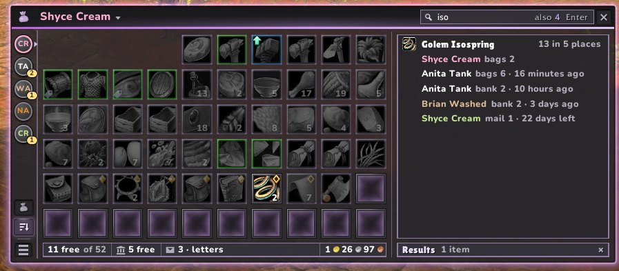
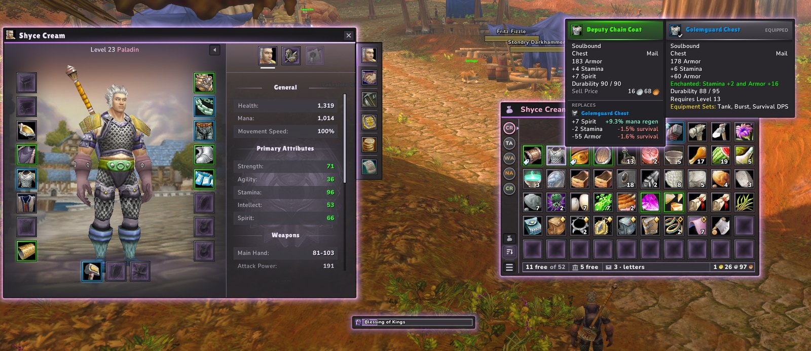
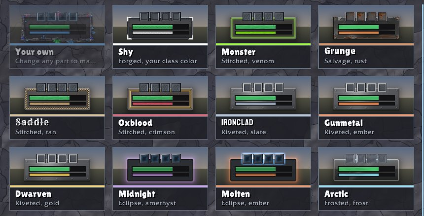

# Shy

  
  
  
  
  
  
  

A family of World of Warcraft addons for WoW Forever: quests, maps, bags, unit frames, chat, the auction house
and more, all in one look you pick once.

## Questing

Your next step is always on screen, with an arrow that takes you there and the route drawn on your map. Take a
flight and the guide counts down until you land.

<table>
  <tr>
    <td width="50%"></td>
    <td width="50%"></td>
  </tr>
</table>

## Dungeons

Every dungeon has its map with the way through, what each boss does, and which of its drops are upgrades for you.

<table>
  <tr>
    <td width="50%"></td>
    <td width="50%"></td>
  </tr>
</table>

## The auction house

See what's cheap against the market right now, and the best places to farm gold at your level.

<table>
  <tr>
    <td width="50%"></td>
    <td width="50%"></td>
  </tr>
</table>

## Bags and gear

Search finds an item on any of your characters, in their bags, bank or mail. Point at a piece of gear and see what
you'd gain and what you'd lose.

<table>
  <tr>
    <td width="50%"></td>
    <td width="50%"></td>
  </tr>
</table>

## Your look

Over thirty themes to pick from, or make your own.

<table>
  <tr>
    <td width="50%"></td>
    <td width="50%"></td>
  </tr>
</table>

## Set it up once

The first time you log in on a character, setup opens and walks you through it: your theme, your layout and how
you want to play your class. It starts on what's recommended, so you can just press Finish. Your keys stay as they
are unless you pick a layout for them, and if you do, your old hotkeys are saved so you can go back any time.

<table>
  <tr>
    <td width="50%"></td>
    <td width="50%"></td>
  </tr>
</table>

## Professions

Which recipes make money, which lose it, and how likely each one is to give you a skill-up.

## What's new in 5.1.3

### Added
- **ShyCore:** A and D can keep turning you instead of strafing. Pick it on their row in your keys, and give strafing or turning a key of your own

### Changed
- **ShyAuction:** Selling a pile now goes up stack by stack, with a strip showing how far along you are. Space posts the next one, and right-clicking an item in your bags picks it on the Sell tab
- **ShyCore:** The game-style red buttons turn their own art around when held, so they look pushed in, and no longer get a second light along the top
- **ShyCore:** The game-style red buttons keep the same thin rim on a tall card as on a small button
- **ShyCore:** The Maximize and Minimize buttons on windows no longer pop up a tooltip
- **ShyDock:** The Screen page in setup is laid out new. A band says what happens to your screen, the layouts are cards, and the sizes, bars and menu sit in two columns under them. The card in use is badged
- **ShyDock:** If you changed the console's layout yourself, setup now leaves it alone and marks it custom. Pick a layout to start fresh
- **ShyThreat:** One threat setting for the meter, nameplates and warrior light, with one aggro sound. The meter counts mobs that got loose from you

### Fixed
- **ShyBags:** Stack counts in your bank slots didn't show when the bank first opened. They show from the start now
- **ShyCore:** Clicking the choice that was already picked made its button flash as if you were pointing at it. It stays still now
- **ShyCore:** The chosen card on the keys page flickered when you pointed at another one. It stays steady now
- **ShyDock:** In a fight your off-hand swing bar went missing while dual wielding. It stays now
- **ShyQuest:** Some quests were offered from level 1 when they are really for high levels, and two Praise quests sent low levels to an empty spot. Both are right now

[Every release](CHANGELOG.md)

## Install

Get **Shy** from CurseForge with the CurseForge app (set the game version to WoW Forever first). Add
**Shy Ground** too if you want routes that follow the terrain; without it, the arrow points straight at where
you're going.

By hand: copy every folder here into `World of Warcraft\_forever_\Interface\AddOns`, and every folder of the
Shy-Ground repository too if you want it.

In game:

- `/shy setup` walks you through setting up the character you're on, all in one go. It opens by itself the first
  time you log in on a character, and you can run it again whenever you want a fresh start.
- `/shy` opens every setting, so you can change one thing at a time. Changes show right away.

## Community

Questions, bug reports and what's coming next: [join the Discord](https://discord.gg/tuJ8EbDdSU).

## License

Free software under the GNU General Public License, version 3 (`LICENSE.txt` in every folder). It is built
with others' work: `ShyCore/CREDITS.txt` names each one and its license, and the same list is in game under
`/shy`, Tools, Sources.

World of Warcraft and its art belong to Blizzard Entertainment. These addons are not made or endorsed by
Blizzard.

Each commit here is one release, exactly as it ships.
