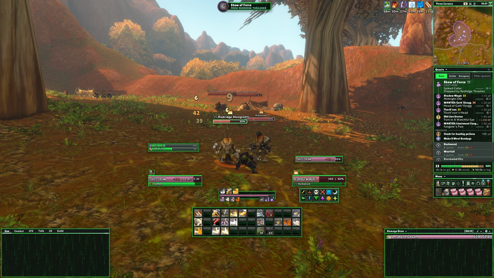
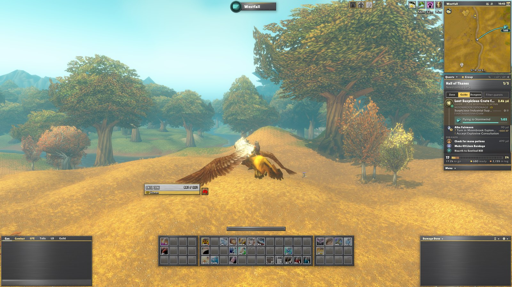
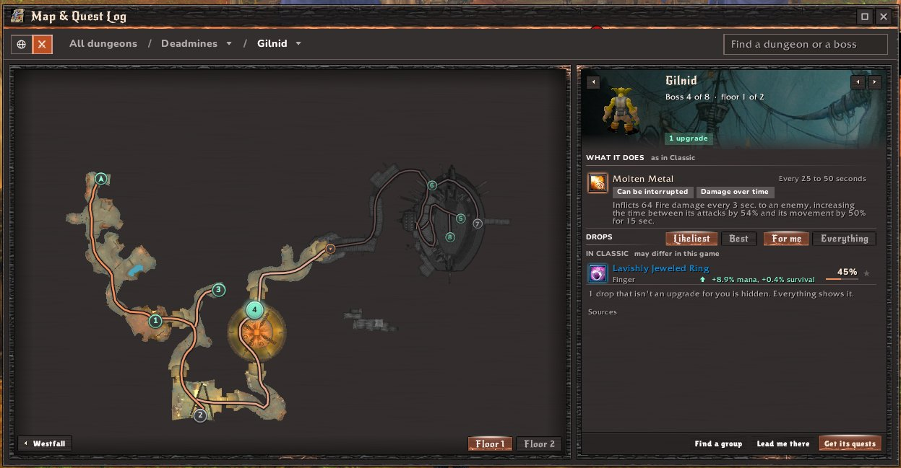
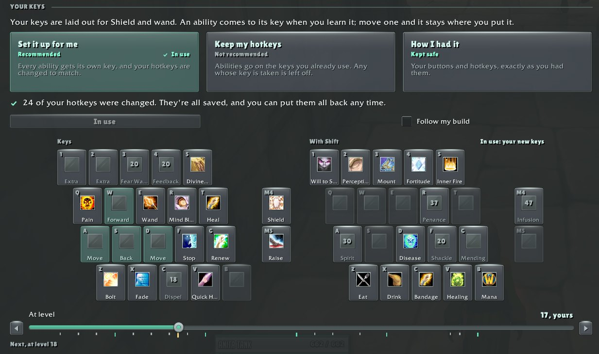

# Shy

  
  
  
  
  
  
  

A family of World of Warcraft addons for WoW Forever: quests, maps, bags, unit frames, chat, the auction house
and more, all in one look you pick once.

## Questing

Your next step is always on screen, with an arrow that takes you there and the route drawn on your map. Take a
flight and the guide counts down until you land.

<table>
  <tr>
    <td width="50%"></td>
    <td width="50%"></td>
  </tr>
</table>

## Dungeons

Every dungeon has its map with the way through, what each boss does, and which of its drops are upgrades for you.

<table>
  <tr>
    <td width="50%"></td>
    <td width="50%"></td>
  </tr>
</table>

## The auction house

See what's cheap against the market right now, and the best places to farm gold at your level.

<table>
  <tr>
    <td width="50%"></td>
    <td width="50%"></td>
  </tr>
</table>

## Bags and gear

Search finds an item on any of your characters, in their bags, bank or mail. Point at a piece of gear and see what
you'd gain and what you'd lose.

<table>
  <tr>
    <td width="50%"></td>
    <td width="50%"></td>
  </tr>
</table>

## Your look

Over thirty themes to pick from, or make your own.

<table>
  <tr>
    <td width="50%"></td>
    <td width="50%"></td>
  </tr>
</table>

## Set it up once

The first time you log in on a character, setup opens and walks you through it: your theme, your layout and how
you want to play your class. It starts on what's recommended, so you can just press Finish. Your keys stay as they
are unless you pick a layout for them, and if you do, your old hotkeys are saved so you can go back any time.

<table>
  <tr>
    <td width="50%"></td>
    <td width="50%"></td>
  </tr>
</table>

## Professions

Which recipes make money, which lose it, and how likely each one is to give you a skill-up.

## What's new in 5.1.7

### Added
- **ShyCore:** A card can hold buttons and items you point at, and one a click keeps goes at the next press anywhere else. Your map opens from anywhere that sends you to it
- **ShyCore:** A window is two surfaces with a setting of its own each: the housing the theme works on, and the sheet its content is read off

### Changed
- **ShyCore:** Every window is made with a sheet of its own, so every one of them answers the same two settings
- **ShyKeys:** Setup's keys page starts on No, so Next and Finish never touch your keys. The keys list names what each key did, gives every key we take one of your own to pick, and keeps strafing on A and D when your arrows strafe
- **ShyKeys:** The Keys page starts with how your keys work and how you move, then the keys that fall out of those two, instead of the list first
- **ShyKeys:** A key's row is one line of cells read straight across, every other one banded, instead of two lines of words with a plate between them
- **ShyKeys:** Nothing of yours is bound until you press Save, on a bar that stays at the window's foot; /shy keys is one page to change a key on, with your keys whole at the top of it
- **ShyKeys:** Your keys keep their own settings now instead of the core's. Your layout, the keys you keep and the way you move all come across the first time it loads, on every profile
- **ShyKeys:** Your keys are an addon of their own now, so you can switch them off and keep the rest of Shy. Your layout, hotkeys and macros are untouched, and the Keys room goes from /shy when the addon is off
- **ShyMaps:** The map's window opens from the game's map key, has room for your quests beside it, and follows you the way you pick: not at all, in the middle, or smart. Notes, sharing and the overlay moved into the map's menu
- **ShyQuest:** Your quests list beside the map's window, and the card, route and offers read better. A stop you put on your route yourself is washed in your color

### Fixed
- **ShyCore:** A bar at the window's foot ran out past the room it belongs to, over the scroll bar
- **ShyCore:** The foot of the hub showed the rail's darker ground and a line through it, cutting it in two. It is one clean strip now
- **ShyCore:** A window of ours hung from a game window, like the mailbox's, kept the screen from fading after you closed the game's. It fades again
- **ShyCore:** Picking a new key for one of your hotkeys could change a different key and move an ability you never touched. The key you clicked is the one that changes now, and the list stays put while you pick
- **ShyCore:** A bar at the window's foot stopped short of the window, and a room left up to fifty pixels unused at its right edge
- **ShyDock:** Your console was told it no longer fit right after you set it up, or after a tiny measuring difference between logins. It only says so when something really changed
- **ShyFarm:** Farms were not being ended properly between closing and switching characters when a new item was looted that you were farming before
- **ShyKeys:** The Save bar stood over the list instead of above it, and a key's row left you guessing which of the two things on it a picker moved
- **ShyKeys:** Hiding a page you never touched put your whole book of keys back to how it looked when that page was built, losing every override you had saved
- **ShyKeys:** The room said Your keys three times over, and the column of keys was named to the wrong edge
- **ShyKeys:** The keys you reach for most were told apart by a colour on the words and nothing else, and the columns were half named
- **ShyKeys:** The arrow by each key was a box the font can't draw, the plates landed wherever their words ended, and the choice named us instead of saying what it does
- **ShyKeys:** A key was said in the capitals the game keeps it under, so a row read Still on LEFT
- **ShyKeys:** A key you had bound to something else was stuck: asking for your new key back did nothing, and picking a key moved the ability instead of what the key did. New key takes it back now, and each key picker says what it moves
- **ShyKeys:** A macro of your own whose lines matched one of ours was deleted when you put your keys back. Anything you wrote before your keys were first laid out is left alone now
- **ShyWay:** Pressing a shared route's offer did nothing in a fight or with your map window open. It opens your map now

[Every release](CHANGELOG.md)

## Install

Get **Shy** from CurseForge with the CurseForge app (set the game version to WoW Forever first). Add
**Shy Ground** too if you want routes that follow the terrain; without it, the arrow points straight at where
you're going.

By hand: copy every folder here into `World of Warcraft\_forever_\Interface\AddOns`, and every folder of the
Shy-Ground repository too if you want it.

In game:

- `/shy setup` walks you through setting up the character you're on, all in one go. It opens by itself the first
  time you log in on a character, and you can run it again whenever you want a fresh start.
- `/shy` opens every setting, so you can change one thing at a time. Changes show right away.

## Community

Questions, bug reports and what's coming next: [join the Discord](https://discord.gg/tuJ8EbDdSU).

## License

Free software under the GNU General Public License, version 3 (`LICENSE.txt` in every folder). It is built
with others' work: `ShyCore/CREDITS.txt` names each one and its license, and the same list is in game under
`/shy`, Tools, Sources.

World of Warcraft and its art belong to Blizzard Entertainment. These addons are not made or endorsed by
Blizzard.

Each commit here is one release, exactly as it ships.
