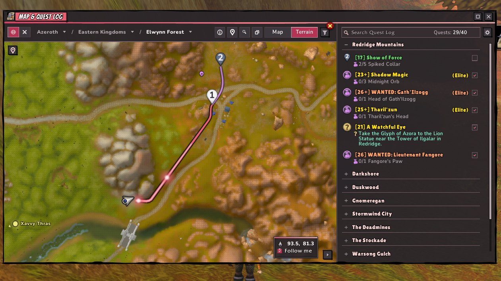
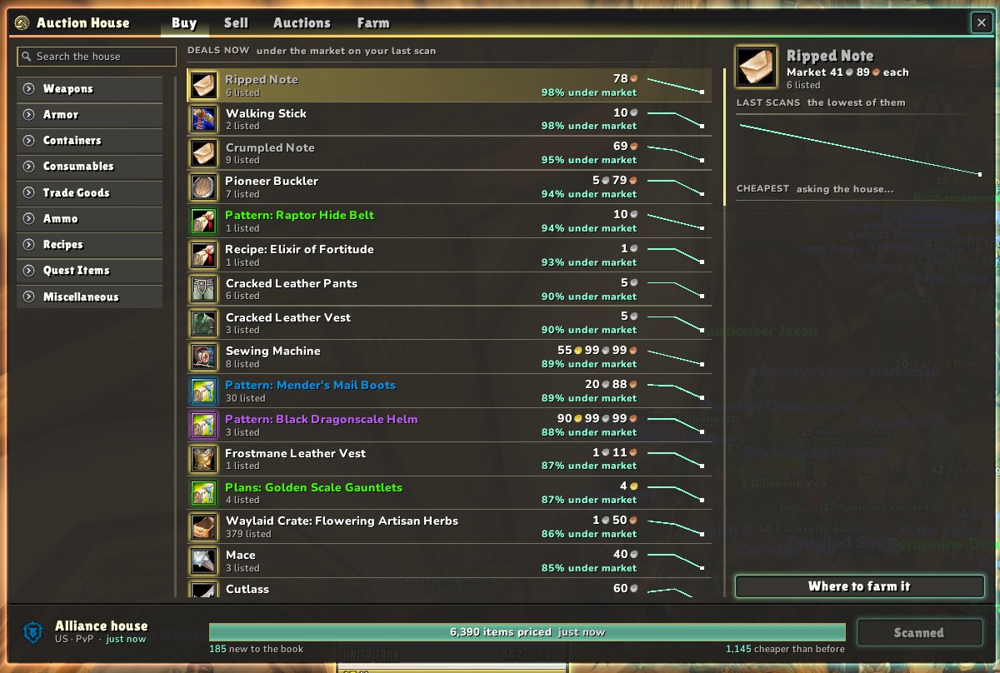

# Shy

  
  
  
  
  
  
  

A family of World of Warcraft addons for WoW Forever: quests, maps, bags, unit frames, chat, the auction house
and more, all in one look you pick once.

## Questing

Your next step is always on screen, with an arrow that takes you there and the route drawn on your map. Take a
flight and the guide counts down until you land.

<table>
  <tr>
    <td width="50%"></td>
    <td width="50%"></td>
  </tr>
</table>

## Dungeons

Every dungeon has its map with the way through, what each boss does, and which of its drops are upgrades for you.

<table>
  <tr>
    <td width="50%"></td>
    <td width="50%"></td>
  </tr>
</table>

## The auction house

See what's cheap against the market right now, and the best places to farm gold at your level.

<table>
  <tr>
    <td width="50%"></td>
    <td width="50%"></td>
  </tr>
</table>

## Bags and gear

Search finds an item on any of your characters, in their bags, bank or mail. Point at a piece of gear and see what
you'd gain and what you'd lose.

<table>
  <tr>
    <td width="50%"></td>
    <td width="50%"></td>
  </tr>
</table>

## Your look

Over thirty themes to pick from, or make your own.

<table>
  <tr>
    <td width="50%"></td>
    <td width="50%"></td>
  </tr>
</table>

## Set it up once

The first time you log in on a character, setup opens and walks you through it: your theme, your layout and how
you want to play your class. It starts on what's recommended, so you can just press Finish. Your keys stay as they
are unless you pick a layout for them, and if you do, your old hotkeys are saved so you can go back any time.

<table>
  <tr>
    <td width="50%"></td>
    <td width="50%"></td>
  </tr>
</table>

## Professions

Which recipes make money, which lose it, and how likely each one is to give you a skill-up.

## What's new in 5.2.0

### Added
- **ShyAuction:** Other parts of the family can open the auction house on an item you pick, with what is listed of it already asked for
- **ShyMaps:** The dungeon journal shows what its players recorded dropping, with the kills they counted. The newest dungeons show roughly where each boss stands and where you come in, marked as rough
- **ShyMaps:** The land between the zones on the drawn map is painted in now, so the world map no longer has bare gaps between its zones
- **ShyQuest:** When a vendor is out of what a quest needs, the card offers the auction house, coming back later, or skipping the quest. The route stops sending you to that vendor, and the guide sets the quest's steps aside until you choose
- **ShyQuest:** Levelling guides now carry you from 1 to 60, for both sides, not only to 30. Where the quests run out the guide sends you to a camp to fight, and a guide that needs a level waits for it at a camp of creatures, never inside a capital city
- **ShyQuest:** Click a quest on your route card and the map opens with that quest's page beside it, flown to where it is done. Click an objective and the map goes to that objective. What you opened stays lit on the card

### Changed
- **ShyDock:** The menu and bag rows under the map keep the size your layout gives them, instead of being shrunk or stretched to fit the map as it is now
- **ShyGroup:** Your group post and your asks now say which roles you already have, like "(2/5, have healer, DPS)". When others write "have tank, need dps", the role after "have" is no longer read as one they want
- **ShyMaps:** The map window opens in the middle of the screen with your quests beside it, as tall as the space over your bars allows and as wide as the map needs. The minimap is the same width at every login
- **ShyMaps:** The map is its own window whenever the drawn map is on. The game's map no longer opens behind it, and the choice between the two is gone
- **ShyQuest:** When your bags are nearly full, the row now lets you make room as well as sell. A click opens your bags with the cheapest things lit, each to drop, even with no shop near
- **ShyQuest:** Newer level data for places, so the route knows better what level the land around a quest is
- **ShyQuest:** Levelling guides count on a mount from level 40, so the long ways between places are shorter. From there they also fight at a camp sooner than cross the world for a quest that pays little
- **ShyQuest:** You are no longer sent to fight what is three or more levels above you while anything in reach gives the same item, and such a fight waits behind the rest of your route. A quest three levels above you counts as too high for now, and a creature seen dropping an item counts as a source of it
- **ShyQuest:** A trip to the bank now waits until you have done what you can right where you stand. You hand in the quest in front of you before you are sent across town
- **ShyQuest:** When an item drops from a few spawns or a rare, the route weighs the work of getting it, not only the walk. You aren't sent for a one-in-a-hundred drop when a nearby camp gives it far more often
- **ShyQuest:** Newer drop chances from what players recorded in this game, so the quests that ask for items point you at the creatures that really drop them. Where nothing is known for an item, the route goes where the quest was seen to advance
- **ShyQuest:** What the addon says in your party chat now starts with <Shy>, so nobody takes it for words you typed
- **ShyQuest:** Newer quest data, with the latest game update, quest experience and fixed quest chains. The guides are planned again from it
- **ShyWay:** Ways now keep to the roads where what lives off them is five or more levels above you, and go straight where it is not. "Roads in higher zones" is the new setting for it, and what you have is kept
- **ShyWay:** Once you ride a mount, ways and routes count its speed. A long walk is ridden and a flight is only taken where it beats the ride
- **ShyXP:** The experience bar under your bars wears your theme's frame, slimmer than a window's, and the bars sit inside it

### Fixed
- **ShyCore:** The page behind a window's text covered the window's frame at the sides and the bottom. It now stops at the frame, and follows when you change the look or its weight
- **ShyCore:** The grey used for captions and counts was too dim to read on the panel. It is brighter now
- **ShyFarm:** The farming card's captions, figures, stats line and clock were hidden under the card and hard to see. They show clearly now
- **ShyKeys:** The How to play pullout's level line, tip and captions were hard to read. They are clear now
- **ShyMaps:** Showing a place on another map left that map as you last had it, and the view often framed nothing. It now opens the whole map and frames the place at once
- **ShyQuest:** The line on the minimap stopped short when your way doubled back close to you. It now carries on while the end of the way would be in sight
- **ShyQuest:** A vendor whose list had dropped what a quest needs was treated as never selling it. They now count as having none for a little while, and the quests that wait on that item wait with it
- **ShyQuest:** During a dungeon run, a place you sent yourself to, a quest you picked or the one you pointed the way to was left off the card until the run ended. They lead the run's steps now, and the arrow points there
- **ShyQuest:** After you learned a flight path, your guide still told you to get it until you reloaded. It goes away by itself now
- **ShyQuest:** Dungeon quests far away, like the Wailing Caverns for an Alliance warrior, came into your guide because another class's errand stood near them. Only what you are ever given counts now
- **ShyQuest:** The words in the Quests your guide skips window were hard to read. They are clear now
- **ShyQuest:** A ride whose walks were still being worked out could be picked over a walk you could already count on. The route now waits for them and is built again once they are known
- **ShyQuest:** The hearthstone was offered as a saving when the way from home was too long to work out. It is only offered now where the way from home is known
- **ShyWay:** The guide thought you knew every flight path, the other side's too. It now learns only the ones you find at a flight master, so yours are learned again the next time you talk to one
- **ShyWay:** Swimming round Orgrimmar's west side could take you through its walls, onto the ground under the city. Walls standing in the water now stop you, and the ways and levels are worked out again

[Every release](CHANGELOG.md)

## Install

Get **Shy** from CurseForge with the CurseForge app (set the game version to WoW Forever first). Add
**Shy Ground** too if you want routes that follow the terrain; without it, the arrow points straight at where
you're going.

By hand: copy every folder here into `World of Warcraft\_forever_\Interface\AddOns`, and every folder of the
Shy-Ground repository too if you want it.

In game:

- `/shy setup` walks you through setting up the character you're on, all in one go. It opens by itself the first
  time you log in on a character, and you can run it again whenever you want a fresh start.
- `/shy` opens every setting, so you can change one thing at a time. Changes show right away.

## Community

Questions, bug reports and what's coming next: [join the Discord](https://discord.gg/tuJ8EbDdSU).

## License

Free software under the GNU General Public License, version 3 (`LICENSE.txt` in every folder). It is built
with others' work: `ShyCore/CREDITS.txt` names each one and its license, and the same list is in game under
`/shy`, Tools, Sources.

World of Warcraft and its art belong to Blizzard Entertainment. These addons are not made or endorsed by
Blizzard.

Each commit here is one release, exactly as it ships.
