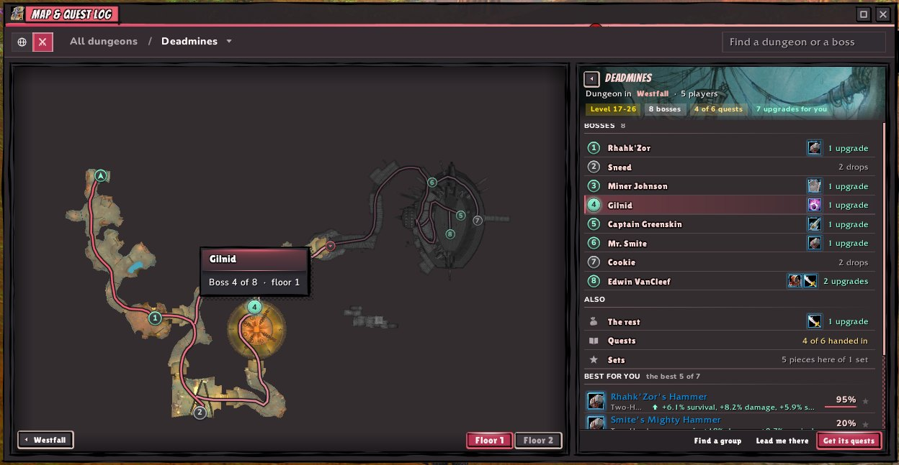
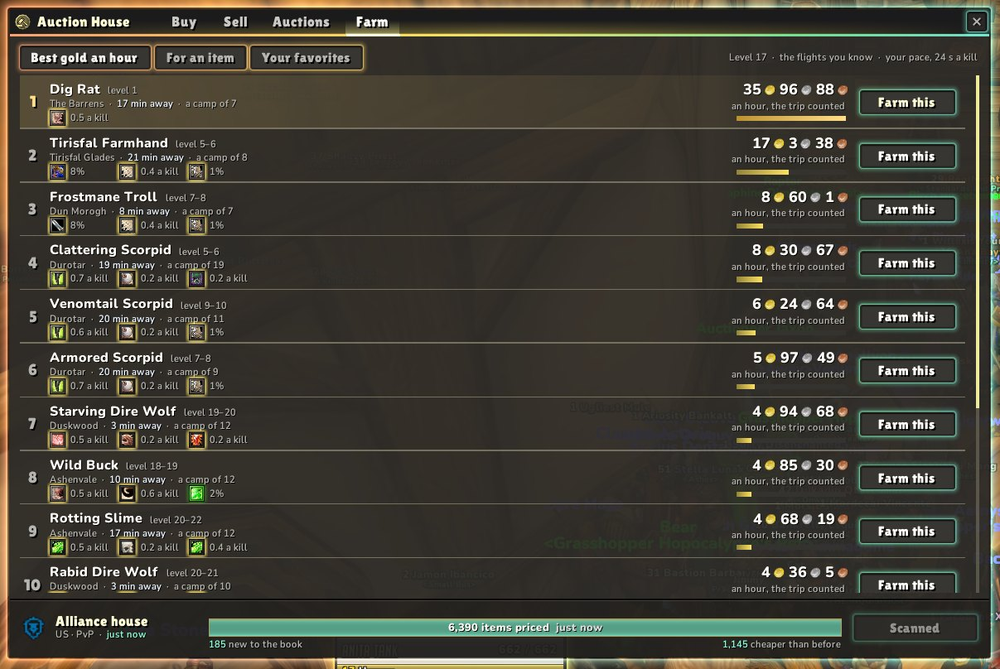
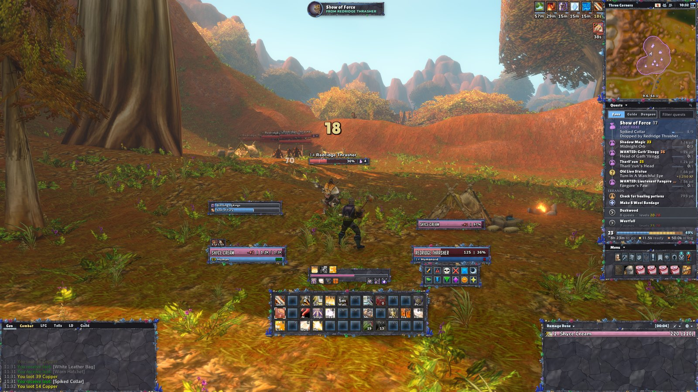
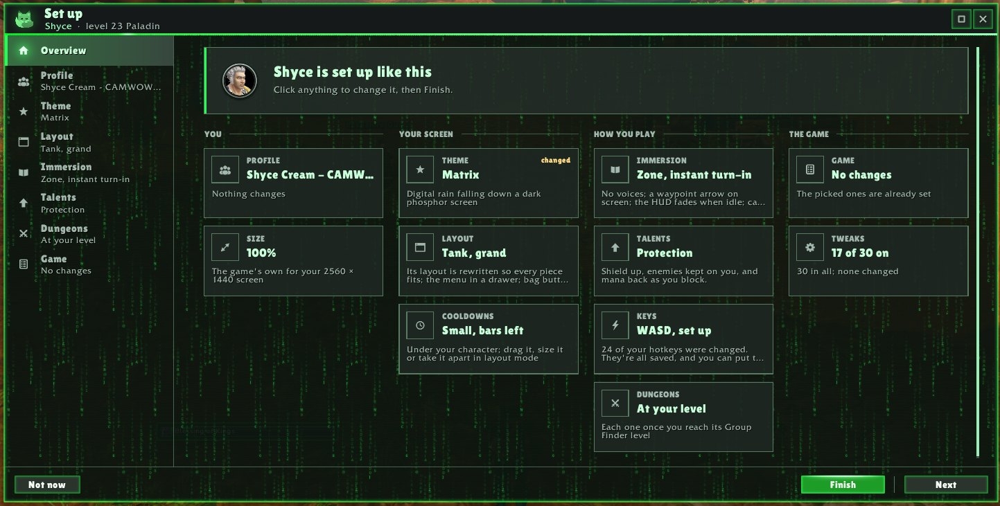
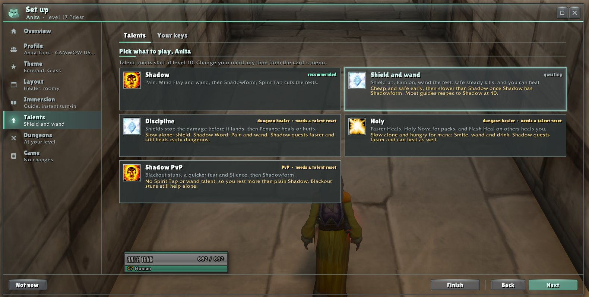
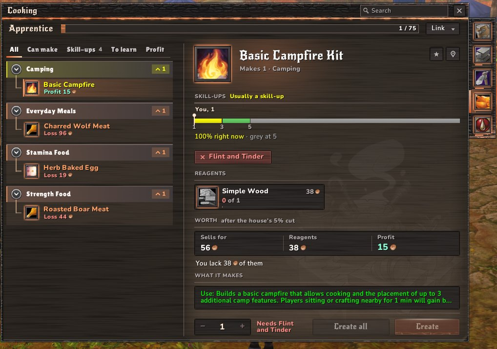

# Shy

  
  
  
  
  
  
  

A family of World of Warcraft addons for WoW Forever: quests, maps, bags, unit frames, chat, the auction house
and more, all in one look you pick once.

## Questing

Your next step is always on screen, with an arrow that takes you there and the route drawn on your map. Take a
flight and the guide counts down until you land.

<table>
  <tr>
    <td width="50%"></td>
    <td width="50%"></td>
  </tr>
</table>

## Dungeons

Every dungeon has its map with the way through, what each boss does, and which of its drops are upgrades for you.

<table>
  <tr>
    <td width="50%"></td>
    <td width="50%"></td>
  </tr>
</table>

## The auction house

See what's cheap against the market right now, and the best places to farm gold at your level.

<table>
  <tr>
    <td width="50%"></td>
    <td width="50%"></td>
  </tr>
</table>

## Bags and gear

Search finds an item on any of your characters, in their bags, bank or mail. Point at a piece of gear and see what
you'd gain and what you'd lose.

<table>
  <tr>
    <td width="50%"></td>
    <td width="50%"></td>
  </tr>
</table>

## Your look

Over thirty themes to pick from, or make your own.

<table>
  <tr>
    <td width="50%"></td>
    <td width="50%"></td>
  </tr>
</table>

## Set it up once

The first time you log in on a character, setup opens and walks you through it: your theme, your layout and how
you want to play your class. It starts on what's recommended, so you can just press Finish. Your keys stay as they
are unless you pick a layout for them, and if you do, your old hotkeys are saved so you can go back any time.

<table>
  <tr>
    <td width="50%"></td>
    <td width="50%"></td>
  </tr>
</table>

## Professions

Which recipes make money, which lose it, and how likely each one is to give you a skill-up.

## What's new in 5.1.1

### Added
- **ShyChat:** Whisper conversations can dock in the chat as tabs beside its own, and each person opens where you last put them. Dragging a tab lights every place it can go, the chat's tabs scroll with the wheel instead of being cut short, and commands like /rl work in a conversation
- **ShyFarm:** Farm a creature for everything it drops, or just record everything you loot. The finder has a farming side with the best farms for you and a search for any item or creature you could farm, and the auction house can open it to pick an item

### Changed
- **ShyBags:** A special bag's slots, like an herb bag's or a quiver's, stand after your other bags' whatever the sort, framed in that bag's color
- **ShyChat:** Chat bubbles wear your look, their tail drawn in the look's own edge, and read clearly in every look. They follow your interface's size, a yell or raid warning wears its own red or orange, and a language you don't speak shows before the words
- **ShyCore:** Setup turns on nameplates for friendly NPCs, so the one your next quest step sends you to shows its mark
- **ShyCore:** Picking a key that already does something, or is picked for something else, asks if you're sure and says where the old use goes, instead of refusing it
- **ShyCore:** Clicking a hover no longer pins it on the screen. It closes when you move away, as every hover does
- **ShyCore:** Colored words on hovers, like an item's quality, stay readable in every look. A color too dark or pale for the background is brightened just enough, keeping its hue
- **ShyCore:** All of Shy's words, down to names, numbers and list lines, wear your look's text effect, so they read on every look's background
- **ShyDock:** The minimal layout shows your main bar alone. Your other bars and side bars fade in while you point at the bars or carry a spell to them, and their keys work all the while
- **ShyDock:** The layout cards in setup are simple flat drawings of your whole screen's foot, all at one scale, so you can tell the layouts apart at a glance

### Fixed
- **ShyCore:** A hover could stand over a menu you had just opened and hide half of it. The menu stands over hovers now, and the hover of what you opened it on closes
- **ShyCore:** In the tooled leather look the carved band round the edge ran under what windows hold, and under chat lines and meter bars on screen. Windows keep their contents clear of it now, a little bigger to make room, and the band stays off pieces with no room for it
- **ShyCore:** In a dungeon run, buttons on the quest card showed a block of the dungeon's color over their pictures. Their highlight stays hidden until you point at them now
- **ShyTweaks:** A spell out of range on a faded bar tinted the world behind it red. The red shows only on bars you can see now

[Every release](CHANGELOG.md)

## Install

Get **Shy** from CurseForge with the CurseForge app (set the game version to WoW Forever first). Add
**Shy Ground** too if you want routes that follow the terrain; without it, the arrow points straight at where
you're going.

By hand: copy every folder here into `World of Warcraft\_forever_\Interface\AddOns`, and every folder of the
Shy-Ground repository too if you want it.

In game:

- `/shy setup` walks you through setting up the character you're on, all in one go. It opens by itself the first
  time you log in on a character, and you can run it again whenever you want a fresh start.
- `/shy` opens every setting, so you can change one thing at a time. Changes show right away.

## Community

Questions, bug reports and what's coming next: [join the Discord](https://discord.gg/tuJ8EbDdSU).

## License

Free software under the GNU General Public License, version 3 (`LICENSE.txt` in every folder). It is built
with others' work: `ShyCore/CREDITS.txt` names each one and its license, and the same list is in game under
`/shy`, Tools, Sources.

World of Warcraft and its art belong to Blizzard Entertainment. These addons are not made or endorsed by
Blizzard.

Each commit here is one release, exactly as it ships.
